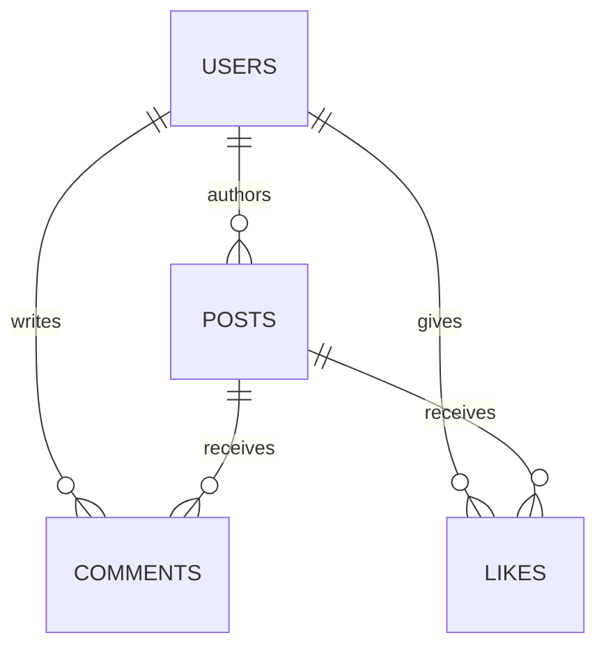

# Web Technologies and Security assignment: reviewed text edition

**Original: Jyothesh Karnam, Keele University, CSC-40046, 2024. Submission date stated in report: 8 May 2024.**

This is a privacy-reviewed text edition prepared on 14 November 2026, not a replacement claim about the original submission. The source DOCX hash and redactions are recorded in [provenance](../PROVENANCE.md). Student identifiers, teaching-server access details, all populated SQL rows and embedded images are omitted. Technical reflection wording is retained; it records the student's 2024 reasoning and can include proposals or simplifications rather than verified controls.

## Design sections in the original report

1. Entity Relationship diagram representing the database design. The embedded image is withheld.
2. Site map showing page structure and filenames. The embedded image is withheld.
3. CREATE TABLE statements and initial-data queries. The public [empty schema](../../database/schema.sql) recovers the table fields/keys with no account records or historical content. Dump-environment identifiers and populated INSERT statements are omitted.

### Relational model reconstructed in 2026 from the submitted DDL

The schema's original fields allow nullable comment/like references; the diagram expresses intended ownership rather than a proof of non-null cardinality. USERS includes identity/profile fields and a hashed password field, POSTS stores text/time/optional-image references, COMMENTS associates text with user/post references, and LIKES enforces a unique user/post pair. Current code is evaluated separately from this historical design.

## Original security reflection (technical text)

A brief reflection on the security issues you need to consider on a website of this type.

Session management and authentication:

Session Hijacking: User authentication is handled by sessions. There is a possibility of session hijacking occurrence if an attacker attempts to steal a session ID. In order to prevent this, the cookies must be sent only over HTTPS. The application should set ‘session.cookie_secure’ to prevent hijacking. additionally, ‘session.cookie_httponly’ will prevent JavaScript access. This will reduce the risk of session information leakage on client-side.

Session Fixation: By using an old session ID or a predictable session ID, there is a possibility of session fixation by the attackers. To prevent this, PHP’s ‘session_regenerate_id()’ should be used after login. This generates new session ID for each user and invalidates the old sessions. This makes it difficult for the attackers to reuse the existing sessions.

Session Timeout: If a user leaves a device unattended then these idle sessions can become a security risk. Implementing a session timeout that automatically logs out a user after a certain period of time of inactivity can prevent the security risk of unauthorised access.

Input Validation and Sanitization:

Cross-site Scripting (XSS): Improper user inputs can have malicious scripts. this can lead to XSS attacks. To prevent this, the user-generated content should be sanitized before it is display. By using functions like ‘htmlspecialchars’ or ‘htmlentities’ will prevent this by converting characters like ‘<’ and ‘>’ to HTML entities (‘&lt;’ and ‘&gt;’). 

SQL Injection: When a user input is directly concatenated into an SQL query, then an SQL injection happens. This will allow an attacker to execute arbitrary queries. To prevent this, statements like ‘prepare’ and ‘bind_param’ counter this risk by separating SQL commands from data inputs. This reduces the risk of injection.

File Upload Security:

File Type Validation: The website allows user to upload image files. This possibly could lead to malicious files being uploaded and executed. By ensuring only specific image types are accepted by checking MIME types.
Also, it is important to implement server-side validations.

File Name Sanitization: Creating unique filenames using unique identifiers or hashing to prevent directory manipulation and overwriting issues.

Upload Directory Permissions: The files uploaded by users must be stored in directories with limited permissions. The upload directories must be ensured that it is non-executable. This will prevent files from being directly executed as scripts.

Access Control:

Authorization Checks: Verification of user action in the website like uploading or deleting a post, should be checked if the user owns the resource. This is possible by comparing the user ID in the session with the resource’s ownership information.

Error Handling: 

Error Exposure: Straightforward error messages possibly could reveal system architecture. By replacing technical messages with user friendly error message. Also, it is important to log the technical errors separately.

Logging: By maintaining logs for all user events like suspicious user activity or failed login attempts. This could help in further investigation.

Password Management:

Password Storage: Currently the application uses ‘password_hash’ to store the passwords securely. However, to improve this, the passwords can be hashed with strong algorithm like ‘bcrypt’. Currently the password has a minimum 8 characters length but it would be better to enforce specific character requirement in the password with minimum length.

Password Reset: Implementing secure password reset. Tokens should be unique and only sent to the verified email addresses. After the password is changed, notifying the users about the changes happened at a particular time via email is important.

Database Security:

Connection Management: Database credentials should be secured using environmental variables instead of directly hardcoding them into the code. This method prevents accidental exposure in version control and protects credentials.

Secure Transport Layer: 

HTTPS usage: Using secure Transport layer security encryption with updated protocols. This benefits in preventing data interception.
